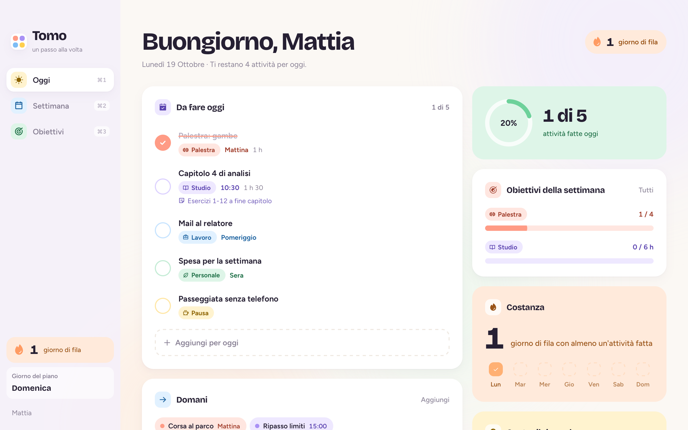
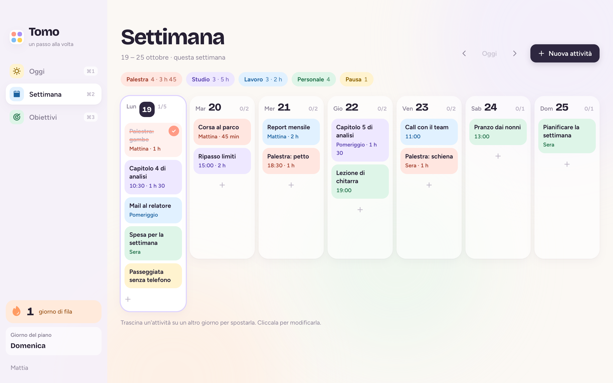

<div align="center">


# Tomo

**Il pianificatore settimanale per smettere di rimandare.**
Decidi la domenica, poi ogni giorno ti mostra solo cosa fare. Tu spunti.




</div>

## Cosa fa

**Oggi.** Le attività del giorno in ordine: prima quelle a un orario o in un momento della giornata, poi le altre. Accanto, quante ne hai fatte, come vanno gli obiettivi della settimana e un consiglio contro il rimandare.

**Settimana.** Sette colonne, una per giorno. Trascini un'attività su un altro giorno per spostarla e in alto vedi quanto tempo dedichi a ogni categoria.

**Obiettivi.** "Palestra 4 volte", "Studio 6 ore": obiettivi a sessioni o a ore, ognuno con il suo perché. Le ore si contano dalla durata delle attività fatte.

**Giorno del piano.** Scegli tu quale (di solito la domenica): quel giorno Tomo ti invita a preparare la settimana successiva.



### Le attività

- **Quando:** in giornata, in un momento (mattina, pomeriggio, sera) o a un orario preciso.
- **Più giorni in un colpo:** palestra lunedì, mercoledì e venerdì si aggiunge una volta sola.
- **Durata e nota facoltative**, per gli obiettivi in ore e per i dettagli (esercizi, capitoli, cosa portare).
- **Categorie tue:** oltre a quelle iniziali ne crei di nuove con nome, colore e una delle 20 icone.

### Senza sensi di colpa

Un'attività saltata ieri non diventa un rimprovero. Ti chiede solo se farla oggi o lasciarla stare. Le giornate saltate apposta non rompono la serie dei giorni di fila: perdonarsi un passo falso aiuta a ripartire, mentre colpevolizzarsi fa rimandare di più ([Wohl, Pychyl e Bennett, 2010](https://doi.org/10.1016/j.paid.2010.01.029)).

### Widget sul tuo Desktop


Una schedina con le attività di oggi e i giorni di fila, larga come i widget di macOS. Puoi spuntare direttamente da lì, aggiungere un'attività o aprire Tomo.

Si accende dalla barra laterale, sta sotto le altre finestre e ricorda dove l'hai messo. Se chiudi Tomo con ⌘Q il widget resta. Con Tomo negli *Elementi login* ce l'hai sempre davanti.

<br clear="right">

## Installare

Dalla pagina **Releases** del repository:

| Sistema | File |
| --- | --- |
| Mac (chip Apple e Intel) | `Tomo-mac.dmg` |
| Windows | `Tomo-windows-setup.exe` |

L'app non è firmata con un certificato Apple. Al primo avvio macOS la blocca: vai in **Impostazioni di Sistema → Privacy e sicurezza** e premi **Apri comunque**. Su Windows, se compare SmartScreen, premi **Ulteriori informazioni → Esegui comunque**.

### Scorciatoie

| Tasti | Azione |
| --- | --- |
| <kbd>⌘</kbd> <kbd>N</kbd> | Nuova attività |
| <kbd>⌘</kbd> <kbd>1</kbd> / <kbd>2</kbd> / <kbd>3</kbd> | Oggi, Settimana, Obiettivi |
| <kbd>⌘</kbd> <kbd>Q</kbd> | Chiude Tomo (il widget, se acceso, resta) |

Su Windows, <kbd>Ctrl</kbd> al posto di <kbd>⌘</kbd>.

### I tuoi dati

Niente account e niente cloud: tutto resta in un file sul computer.

- Mac: `~/Library/Application Support/com.mattiadelia.tomo/data.json`
- Windows: `%APPDATA%\com.mattiadelia.tomo\data.json`

## Sviluppo

Servono [Node.js](https://nodejs.org) e [Rust](https://rustup.rs).

```sh
npm install
npm run tauri dev     # l'app in una finestra, con ricarica automatica
npm run dev           # solo l'interfaccia nel browser, su http://localhost:1420
```

Nel browser il widget si apre con `http://localhost:1420/?widget`.

### Compilare

```sh
npm run build:mac     # Tomo.app in src-tauri/target.noindex/release/bundle/macos
```

Gli installer per Mac (`.dmg` universale) e Windows (`.exe`) li compila GitHub Actions (`.github/workflows/build.yml`): a mano dalla scheda Actions, oppure con un tag `v*` che li pubblica anche in Releases.

### Com'è fatto

[Tauri 2](https://tauri.app) (Rust) con React 19, TypeScript, Vite e Zustand. Animazioni con [Motion](https://motion.dev), icone [Phosphor](https://phosphoricons.com), font Bricolage Grotesque e Figtree inclusi nell'app.

```
src/
  views/       Oggi, Settimana, Obiettivi e il widget
  components/  finestre per attività e obiettivi, selettore delle categorie, elementi base
  model/       tipi, date, calcoli su attività, obiettivi e serie, consigli
  state/       stato dell'app e salvataggio
  platform/    l'unico punto che parla con Tauri (nel browser usa alternative web)
src-tauri/     guscio Rust: salvataggio dei dati, finestra del widget, menu
```
